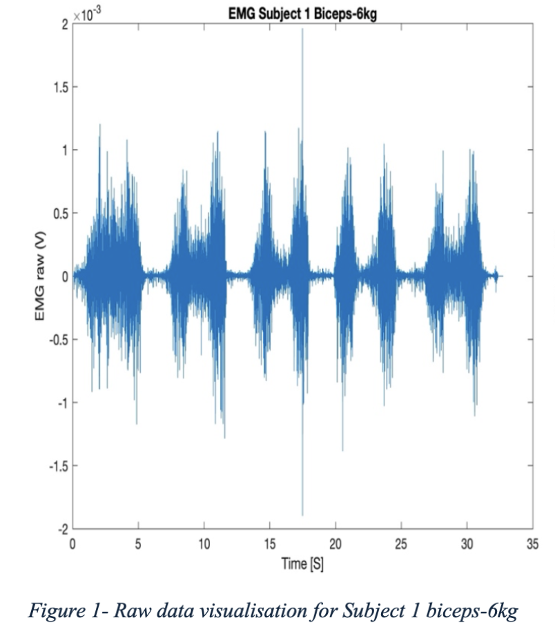
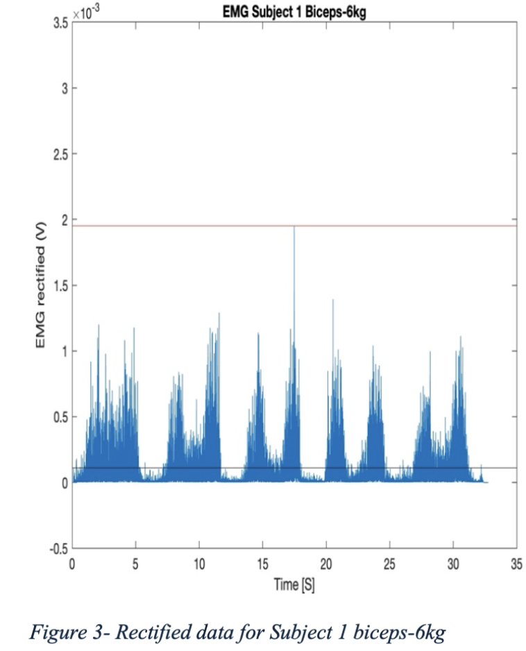
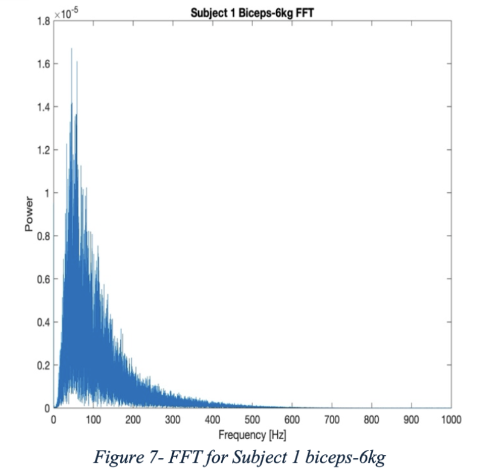

# EMG Signal Analysis

## Overview

Biomedical engineering laboratory project investigating muscle activation patterns in the biceps and triceps during biceps curls using surface electromyography (EMG).

## Project Aim

The project aimed to record and analyse EMG signals from the biceps and triceps during biceps curls performed with different weights, and investigate differences in muscle activation throughout the movement.

## My Work

I:

- Recorded surface EMG signals from the biceps and triceps during biceps curls
- Collected data across different loading conditions: no weight, 2 kg, 4 kg and 6 kg
- Processed the raw EMG data using MATLAB
- Applied notch and bandpass filtering to reduce signal noise
- Rectified and smoothed the EMG signals
- Calculated maximum amplitude and mean rectified signal values
- Calculated Root Mean Square (RMS) values to assess overall signal strength
- Used Fast Fourier Transform (FFT) analysis to examine signal frequency characteristics
- Compared activation patterns between the biceps and triceps
- Investigated sources of signal noise and adapted sensor placement to improve recording quality
## Project Visuals

### Raw EMG Signal

Raw surface EMG recording from the biceps during a 6 kg biceps curl, showing the signal before processing.

### Rectified EMG Signal

Rectified biceps EMG signal after processing, allowing muscle activation to be examined more clearly.

### Frequency-Domain Analysis

Fast Fourier Transform (FFT) of the biceps EMG signal during the 6 kg curl, showing its frequency characteristics.

## Key Findings

The biceps consistently showed greater muscle activation than the triceps during the biceps curl, with higher maximum amplitude, mean rectified signal and RMS values.

The biceps signal also showed a more defined peak at lower frequencies in the FFT analysis, indicating stronger and more synchronised activation during the lifting phase.

The experiment also highlighted the importance of sensor placement and signal quality, as poor sensor contact and movement introduced noise that required troubleshooting.

## Data Processing

The raw EMG signals were processed in MATLAB using:

- Notch filtering
- Bandpass filtering
- Signal rectification
- Signal smoothing
- Maximum amplitude analysis
- Mean rectified signal analysis
- Root Mean Square (RMS) analysis
- Fast Fourier Transform (FFT) analysis

## Experimental Setup

Two participants performed biceps curls using their dominant hands.

Weights of:

- No weight
- 2 kg
- 4 kg
- 6 kg

were tested, with repeated curls performed under controlled timing using a metronome.

EMG sensors were positioned over the biceps and triceps with orientation aligned to the direction of the muscle fibres.

## Software & Equipment

- MATLAB
- Delsys Trigno wireless EMG system
- Surface EMG sensors

## Skills Demonstrated

- Biomedical signal processing
- EMG analysis
- MATLAB
- Experimental design
- Data collection
- Quantitative analysis
- Statistical analysis
- Signal filtering
- Data interpretation
- Troubleshooting
- Technical reporting

## Project Materials

- [View Project Report](./emg-signal-analysis-report.pdf)
